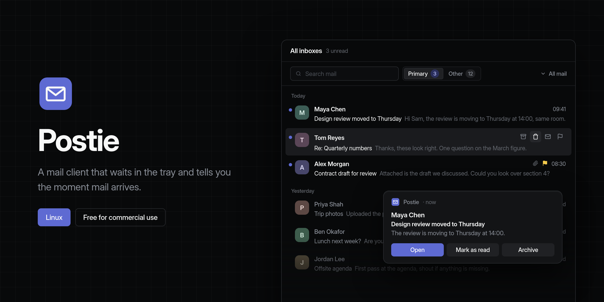
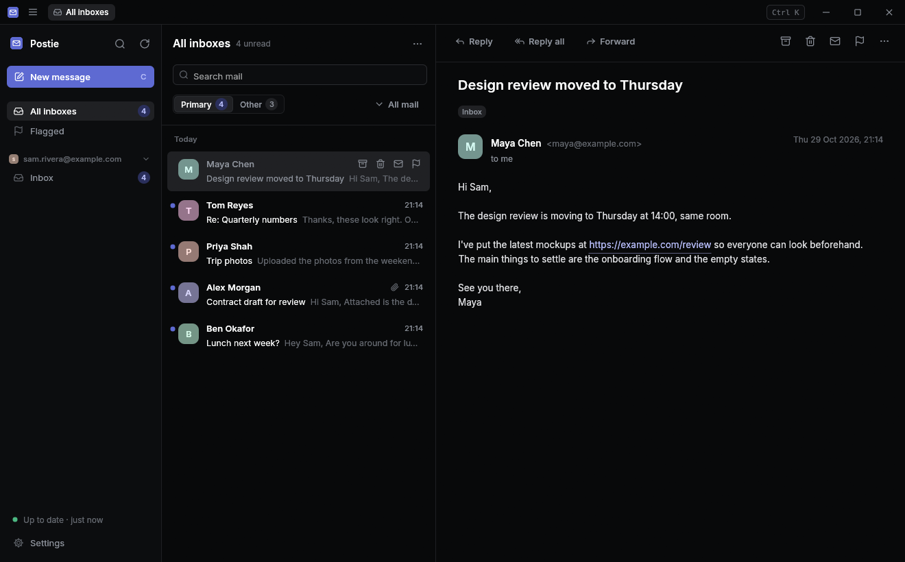

<p align="center">
  
</p>

<p align="center">
  <a href="https://github.com/CookieJarTools/Postie/releases/latest"></a>
  
  <a href="LICENSE.md"></a>
</p>

<p align="center">
  <a href="https://github.com/CookieJarTools/Postie/releases/latest"><b>Download for Linux</b></a>
  &nbsp;·&nbsp;
  <a href="#getting-started">Getting started</a>
  &nbsp;·&nbsp;
  <a href="#building-from-source">Build from source</a>
</p>

Postie is a mail client for Linux that stays out of your way. It starts when you log in, sits in the tray, and shows a notification the moment a new email arrives, so you don't need a mail window open all day. When you do open it, all your accounts are in one place, sorted so the mail from people comes first.

It works with Gmail, Outlook.com, Microsoft 365, iCloud, Yahoo, Fastmail and any other email provider that offers IMAP.

## What it does

### Tells you when mail arrives

New mail shows up within a second or two of reaching your inbox, as a desktop notification with **Open**, **Mark as read** and **Archive** buttons on it. When a lot arrives at once you get one summary instead of a stack of popups. **Do not disturb** in the tray menu pauses notifications without stopping anything else.

Postie starts with your computer and lives in the tray. Closing the window doesn't stop it, so notifications keep coming; quit from the tray menu when you want it gone.

### Primary and Other

Each inbox is split in two, like Outlook's Focused Inbox. People you write to, replies to your own emails and anything marked urgent stay in **Primary**. Newsletters, mailing lists, receipts and other automated mail go to **Other**, out of the way until you want them.

If something lands in the wrong place, right-click it and choose **Move to Primary** or **Move to Other**. Postie remembers, and mail from that sender goes there from then on. Notifications and the unread count only count Primary, so a newsletter never interrupts you. You can change both in Settings.



### All your accounts in one place

Add as many accounts as you like. **All inboxes** shows them together, and each account has its own folders underneath. Drag an account in the sidebar to change the order they're listed in.

### Quick to work through

Everything you do happens straight away, even when you're offline; Postie catches the server up in the background. Hover over a message to archive, delete, flag or mark it read without opening it, or use the keyboard:

| Key | |
| --- | --- |
| J / K | Next / previous message |
| E | Archive |
| # or Delete | Delete |
| R / A / F | Reply / reply all / forward |
| S | Flag |
| U | Mark read or unread |
| C | New message |
| Ctrl+Enter | Send |
| / | Search |
| Ctrl+K | Do anything: every action and folder, by typing a few letters |

### Reading without being tracked

Emails open in a calm, simplified view with their images held back, because remote images let senders see when you've opened their mail. When you want to see an email the way it was designed, press **Show images**: it appears on a white page in the sender's own colours with its pictures in place. **Always for** that sender remembers your choice. **Open in browser** shows the exact original layout.

Hovering a link shows where it really goes before you click it. Attachments open or save from the top of the message, and **Unsubscribe** appears whenever the sender offers one.

If you find plain text easier to read in a fixed-width font, turn on **Monospace message text** in Settings.

### Writing

Reply, reply all or forward (forwarding brings the attachments along). Addresses fill themselves in as you type, from the people you've emailed before. Each account can have its own signature, and anything you start writing is saved as a draft until you send it or throw it away.

After you send, an **Undo** button stays on screen for a few seconds in case you spot a typo. If a message can't be sent, for example because you're offline, it waits in the **Outbox** and you can try again.

### Finding things

Postie keeps all of your mail on your computer, so search finds emails from years ago as quickly as today's. It covers who sent an email, who it was to, its subject and its text, in every folder except Trash and Junk; switch to **This folder** to look in just the one you're in. You can narrow it down with `from:ann`, `to:ben`, `subject:invoice`, `is:unread`, `is:flagged` or `has:attachment`, and the filter button shows only unread, flagged or messages with files.

When you first add an account, your newest mail appears straight away and the rest downloads in the background; the sidebar shows how much is left. If you'd rather keep only recent mail, turn off **Keep all mail on this computer** in Settings.

## Getting started

The easiest way to install Postie is [The Jar](https://github.com/CookieJarTools/TheJar), which installs CookieJarTools apps and keeps them up to date. Find Postie in its library and press **Install**.

Or download **Postie-&lt;version&gt;.AppImage** from the [latest release](https://github.com/CookieJarTools/Postie/releases/latest), make it executable and open it:

```bash
chmod +x Postie-<version>.AppImage
./Postie-<version>.AppImage
```

Postie asks for your first account straight away. Type your email address and it fills in the rest for the common providers.

- **Outlook.com, Hotmail and Microsoft 365:** choose **Sign in with Microsoft**. Your browser opens to Microsoft's own sign-in page; Postie never sees your password.
- **Gmail:** Google doesn't let mail apps use your normal password. Turn on 2-Step Verification in your Google account, then make an **app password** at [myaccount.google.com/apppasswords](https://myaccount.google.com/apppasswords) and paste that into Postie.
- **iCloud, Yahoo and Fastmail** also want an app password, which you make in their account settings.
- **Anything else:** Postie guesses the servers from your address. If it can't connect, open **Server settings** and fill in the IMAP and SMTP details from your provider's help pages.

Once your account is in, Postie downloads your newest mail and starts itself every time you log in. Click the tray icon to open it, or right-click the icon for new message, check for mail, Do not disturb and quit.

## Building from source

You need Rust 1.88 or newer.

```bash
cargo build --release
./target/release/postie install
```

| Command | What it does |
| --- | --- |
| `cargo build --release` | Build `target/release/postie` |
| `cargo test` | Run the tests |
| `postie install` | Copy Postie to `~/.local/bin`, add it to your app menu, start it at login and start it now (`--no-login` to skip starting at login) |
| `packaging/linux/build-appimage.sh <version>` | Pack the release build into `dist/Postie-<version>.AppImage` (needs `appimagetool`) |
| `scripts/render-banner.sh` | Rebuild `docs/banner.png` from `scripts/banner/banner.html` with headless Firefox |
| `POSTIE_SCREENSHOT=shot.ppm postie window` | Save what the window draws after a few seconds and quit, for screenshots like the one above |

Releases are made from **Actions › Release › Run workflow**, which tests `main`, builds the AppImage, tags it and publishes it.

<details>
<summary><b>Trying changes without touching your real mail</b></summary>

<br />

[GreenMail](https://greenmail-mail-test.github.io/greenmail/) is a test mail server that accepts any login. Run it, and point `XDG_CONFIG_HOME` and `XDG_DATA_HOME` at a spare folder so the test copy of Postie keeps its own settings and mail:

```bash
podman run -d --rm --name greenmail -p 127.0.0.1:3025:3025 -p 127.0.0.1:3143:3143 \
  -e GREENMAIL_OPTS='-Dgreenmail.setup.test.smtp -Dgreenmail.setup.test.imap -Dgreenmail.hostname=0.0.0.0 -Dgreenmail.auth.disabled' \
  docker.io/greenmail/standalone:2.1.3
```

Then add an account with any address and password, IMAP `127.0.0.1:3143`, SMTP `127.0.0.1:3025` and security **None**.

</details>

Built with Rust and egui.

## How it works

The sections below go into more detail. You don't need any of this to use Postie.

<details>
<summary><b>The background service and the window</b></summary>

<br />

`postie daemon` is the part that runs all the time: one sync worker per account, each on its own thread, plus the tray icon, the notifications and a small control socket. The window is a separate process that the service starts when you click the tray icon or a notification, so closing it frees all of its memory while the service carries on.

Running `postie` with no arguments asks the service to show the window, and starts the service first if it isn't running. `postie compose`, `postie mailto:...`, `postie sync` and `postie quit` do what they say.

At login the service runs as the `postie.service` systemd user service, which also restarts it if it ever crashes. Desktops without systemd get an autostart entry instead.

</details>

<details>
<summary><b>Syncing</b></summary>

<br />

Each account keeps one IMAP connection for syncing and a second sitting in IDLE on the inbox, which is how new mail turns up within a second or two instead of on a timer. Other folders are checked every few minutes. A new account's first sync takes the newest 400 messages of each folder, headers first so the list appears quickly. After that, each round of syncing also fetches a batch of older messages (inbox first, then the other folders) and a batch of message bodies, newest first, until everything is on your computer. New mail and your own changes are dealt with first in every round, so they never wait behind the download. Messages over 4 MB download when you open them.

Mail that was imported or copied into an account (when moving from another provider, for example) is dated by the email's own date rather than the day it was imported.

Everything you do in the window (reading, flagging, archiving, sending) is applied to the local copy at once and queued. The service replays the queue on the server. Each change waits for the server to confirm it, and after a quiet spell the connection is checked before it's trusted, so a change made just as a connection dropped is tried again rather than lost.

</details>

<details>
<summary><b>How Primary and Other decide</b></summary>

<br />

In order: a choice you've made for that sender, then whether the email is a reply to one of yours, whether it's marked high importance, and whether you've written to the sender before. Any of those keeps it in Primary. Otherwise it goes to Other when it carries the marks of bulk mail: unsubscribe and mailing-list headers, `Precedence: bulk`, `Auto-Submitted`, or a no-reply style address. Everything else stays in Primary.

</details>

<details>
<summary><b>Signing in with Microsoft</b></summary>

<br />

Outlook.com and Microsoft 365 no longer accept passwords from mail apps, so Postie signs in with OAuth. Your browser does the sign-in and hands a one-time code back to Postie through a port on your own computer. Postie keeps only the refresh token Microsoft gives it, and uses it to get a fresh access token every hour. You can revoke it at any time from your Microsoft account's privacy settings.

</details>

<details>
<summary><b>The simplified and original views</b></summary>

<br />

The simplified view turns the email's HTML into styled text in Postie's own colours: headings, bold, links and quotes kept, the sender's colours and images left out. Nothing is fetched from the internet to show it.

The original view keeps the sender's colours and backgrounds and puts their images in the flow, on a white page because that's what most email is designed for. Images inside the email are shown from the email itself; images on the web are fetched only once you've asked, without cookies. If a sender's colour would vanish against white, it's shown in dark grey instead.

</details>

<details>
<summary><b>Where data is stored</b></summary>

<br />

| | |
| --- | --- |
| `~/.config/postie/settings.json` | Your accounts and settings |
| `~/.config/postie/credentials.json` | App passwords and Microsoft sign-in tokens, readable only by you |
| `~/.local/share/postie/mail.db` | Your downloaded mail, drafts, outbox and Primary/Other choices |

</details>

<details>
<summary><b>Project layout</b></summary>

<br />

| | |
| --- | --- |
| `src/daemon/` | The background service: workers, tray, notifications, control socket |
| `src/mail/sync.rs` | Per-account sync, IDLE, replaying queued changes, sending |
| `src/mail/oauth.rs` | Microsoft sign-in |
| `src/mail/parse.rs`, `compose.rs` | Reading emails; building replies, forwards and outgoing mail |
| `src/store.rs` | The local store, the change queue, the outbox, drafts, contacts, Primary and Other |
| `src/gui/` | The window |
| `src/autostart.rs` | App menu entry, icon and start at login |

</details>

## Ideas for later

- A calendar and contacts
- Rules for moving mail as it arrives
- Grouping emails into conversations
- Writing formatted (HTML) email
- Dragging emails onto folders to move them
- Windows support

## Licence

Postie is released under the [PolyForm Shield License 1.0.0](LICENSE.md). You can use it for anything, including at work. The one thing you can't do is use it to build a product that competes with Postie itself.
